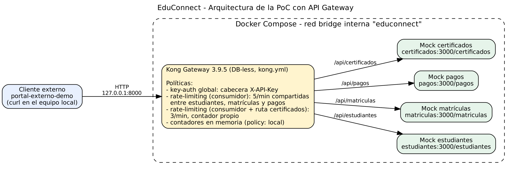

# EduConnect - PoC de API Gateway con Kong

Materia: Integración de Sistemas

**Integrantes:** Romel Gualoto, Paulo Olivo, Issac Trujillo, Brandon Arellano

Un único punto de entrada para cuatro APIs simuladas, con autenticación por API Key y límite de consumo.

Repositorio: https://github.com/Romelg18/educonnect-api-gateway

## Arquitectura


## Requisitos
- Windows con Docker Desktop en ejecución y Docker Compose v2.
- `curl.exe` y PowerShell (incluidos en Windows) para `pruebas.cmd`.
- Puerto 8000 libre.
- Conexión a internet la primera vez, para descargar las imágenes.

No hace falta instalar Node.js ni configurar nada fuera de esta carpeta.

## Versiones
| Componente | Imagen | Motivo |
|---|---|---|
| Kong Gateway | `kong:3.9.5` | Imagen oficial de Docker Hub; era el parche 3.9.x más reciente publicado allí al preparar la PoC (25/11/2026). Versión fija para que sea reproducible. |
| Mocks | `node:22-alpine` | Imagen ligera; el servidor no usa dependencias externas. Fija la versión mayor, no el parche. |

Kong se ejecuta en modo DB-less: toda la configuración está en `kong/kong.yml`.

## Estructura
```text
docker-compose.yml   Kong, cuatro mocks y red interna
kong/kong.yml        Services, Routes, Consumer y Plugins
mocks/server.js      Código de los cuatro mocks (cambia SERVICE_NAME)
pruebas.cmd          Pruebas positivas y negativas con la configuración final
evidencias/          Matriz y salidas originales de cada reto
historial/           Scripts usados para obtener las salidas originales
docs/                Diagrama de arquitectura
```

## Arranque
```powershell
docker compose up -d --wait
docker compose ps
docker compose exec kong kong version
```

Tras cambiar `kong/kong.yml`:
```powershell
docker compose up -d --wait --force-recreate kong
```
Tras cambiar `mocks/server.js`:
```powershell
docker compose restart estudiantes matriculas pagos certificados
```

## URLs
Dirección pública: `http://localhost:8000` (solo accesible desde el propio equipo).

| Ruta pública | Backend interno | Límite del consumidor de prueba |
|---|---|---|
| `/api/estudiantes` | `http://estudiantes:3000/estudiantes` | 5 por minuto, compartidas |
| `/api/matriculas` | `http://matriculas:3000/matriculas` | 5 por minuto, compartidas |
| `/api/pagos` | `http://pagos:3000/pagos` | 5 por minuto, compartidas |
| `/api/certificados` | `http://certificados:3000/certificados` | 3 por minuto, contador propio |

Los mocks no publican puertos. La API de administración de Kong está desactivada.

## Autenticación
Cada solicitud necesita la cabecera `X-API-Key`. La clave del consumidor `portal-externo-demo` está en `kong/kong.yml` (`keyauth_credentials`). Es **ficticia y solo para pruebas locales**; no debe usarse como secreto real. No se acepta en la URL ni en el cuerpo.

```powershell
curl.exe -i -H "X-API-Key: <clave de kong.yml>" http://localhost:8000/api/estudiantes
```

## Reproducir las pruebas
```powershell
.\pruebas.cmd
```
La salida queda en `evidencias\repeticion\pruebas.txt` y no reemplaza las evidencias originales. Cada petición indica el estado esperado, pero el script **no lo valida automáticamente**: hay que compararlo con la respuesta.

| Bloque | Qué comprueba | Estados esperados |
|---|---|---|
| A | Cuatro rutas sin clave, con clave incorrecta y válida; ruta no registrada | 401, 401, 200; 404 |
| B | Límite general compartido | cinco 200 y luego 429 en las tres rutas |
| C | Límite de certificados e independencia | tres 200, un 429; estudiantes 200 |
| D | `pagos` detenido y recuperación | 503; las otras 200; pagos 200 tras recuperarse |

El script recrea Kong entre bloques para reiniciar los contadores y, en B y C, espera al inicio de un minuto. Si se interrumpe en el bloque D, ejecute `docker compose start pagos`.

En las pruebas originales, Kong devolvió 503 al consultar `pagos` poco después de reactivarlo y 200 en una consulta posterior. Por eso el bloque D espera 45 segundos.

## Evidencias
La matriz está en `evidencias/matriz.md`. Cada salida original corresponde a la configuración que había en ese momento; por ejemplo, el 404 del Reto 0 se obtuvo antes de crear las rutas.

El respaldo documental de las decisiones está en [docs/contraste-decisiones.md](docs/contraste-decisiones.md).

## Detener
```powershell
docker compose down
```

## Diagnóstico
```powershell
docker compose ps -a
docker compose logs kong
docker compose logs estudiantes matriculas pagos certificados
```
Revise en orden: contenedores, mock dentro de la red, ruta, API Key, límite y respuesta del backend.

## Alcance
La PoC no resuelve autorización de negocio, identidad de usuarios finales, monitoreo distribuido integral ni alta disponibilidad de producción. Usa HTTP sin cifrado, solo en local.
